# LoadWatch

[](https://github.com/ST10443760/loadwatch---temp/actions/workflows/ci.yml)

**Technical report, Final POE.** PROG7314 / OPSC7312, Group 12 (Loadwatchers).

LoadWatch is a load-shedding companion app for Android, backed by its own REST API on Azure. This report
describes what the app does, how it is built and why, and how to build, run and release it.

## Demo video

- Final POE demo: https://youtu.be/58R_FcGHFZ0
- Part 2 prototype demo: https://youtu.be/Tpmgyyzz67U

## Contents

1. [Purpose](#1-purpose)
2. [The problem it solves](#2-the-problem-it-solves)
3. [Features](#3-features)
4. [Architecture](#4-architecture)
5. [Design decisions](#5-design-decisions)
6. [API endpoints](#6-api-endpoints)
7. [Database schema](#7-database-schema)
8. [Security](#8-security)
9. [DevOps](#9-devops)
10. [Languages supported](#10-languages-supported)
11. [Screenshots](#11-screenshots)
12. [How to build and run](#12-how-to-build-and-run)
13. [AI usage](#13-ai-usage)
14. [Release notes and Play Store readiness](#14-release-notes-and-play-store-readiness)

## 1. Purpose

LoadWatch answers one question for a South African household: **is my power on, when does it go off, and
when does it come back?** You choose your suburb once. From then on the app shows the current supply state,
the next scheduled outage and a live countdown to it. It also shows how far the published schedule can be
trusted in your area, based on what other residents report.

## 2. The problem it solves

Load-shedding schedules are published per area and per stage, and the stage can change at short notice.
Households have to work out their own block, follow stage announcements, and keep re-checking the timetable.
Existing apps show the timetable but leave three gaps:

- **Remaining time.** They give a start time, not how long is left until power goes off or comes back.
- **Whether the schedule is right.** Residents report outages in free-form chat that cannot be measured.
  Nobody can say how often the schedule actually matched reality in an area.
- **No connection during an outage.** Mobile networks are often congested or down during load-shedding,
  which is exactly when the information is needed.

LoadWatch closes these gaps:

- A countdown worked out on the phone.
- A structured two-state report (power off or power back on) that the API aggregates into a per-area
  accuracy score.
- An offline-first design: every screen reads from the phone's own database, and anything done offline
  syncs later.

## 3. Features

### Mandated capabilities

| Capability | How LoadWatch provides it |
|---|---|
| Single sign-on | Google sign-in through Credential Manager and Firebase Authentication. The session survives relaunch, and sign-out clears the user's data from the phone. |
| Settings | Alert lead time, alert types, language, theme and biometric unlock, saved in Room and synced to the API |
| Own REST API and database | ASP.NET Core 8 Web API on Azure App Service, with an Azure SQL database through EF Core |
| Biometric authentication | Optional unlock with fingerprint, face or the screen lock each time the app opens |
| Offline mode with sync | Room is the source of truth for every screen. Changes made offline wait in a queue that WorkManager sends when connectivity returns. |
| Real-time notifications | Firebase Cloud Messaging, with one topic per area |
| Multi-language support | English, isiZulu and Afrikaans, switchable inside the app |

### The five user-defined features

| # | Feature | What it does | Why it is new |
|---|---|---|---|
| 1 | Live countdown | Home shows time until power goes off, or until it returns, ticking every second on the phone. It rolls over to the next window by itself. | It turns a timestamp into an action cue at no extra network cost. |
| 2 | Community outage confirmation and accuracy score | A signed-in user reports *Power is off* or *Power is back* for their area. The API removes repeat reports and turns them into a per-area accuracy score. | It gives the first structured measure of how often the published schedule matches reality. |
| 3 | Favourites and compare | Save several areas, such as home, work and family, and see their next events and countdowns side by side | It answers the question of where the power is on right now across several places, on one screen. |
| 4 | Stage-change alerts | The API notices when an area's stage changes and pushes an alert to that area's FCM topic. The phone shows it in the user's language, with the next outage if it falls within the lead time. | The alert comes from the server's view of the change and goes only to phones that follow that area. |
| 5 | Outage history and calendar | A month calendar and a list of the area's past outages. Days are shaded by hours without power, with the community reports for each day. Works offline for any month seen before. | Laying past schedules over past reports gives the long-run evidence behind the accuracy score. |

### Screens

| Id | Screen | Purpose |
|---|---|---|
| S01 | Splash | Restores the session and decides where to go |
| S02 | Sign in | Google single sign-on |
| S03 | Area onboarding | First area choice |
| S04 | Home | Supply state, next event, live countdown, stage |
| S05 | Area selector | Search and switch area, or add a favourite |
| S06 | Schedule | 3, 7 or 14 days of windows, with a stale-data badge |
| S07 | Report | Community confirmation and accuracy score |
| S08 | Compare | Favourites side by side |
| S09 | Settings | Alerts, language, theme, biometric unlock, sign-out |
| S10 | Outage history | Month calendar and list of past outages and reports |
| | App lock | The biometric prompt shown on launch |

## 4. Architecture

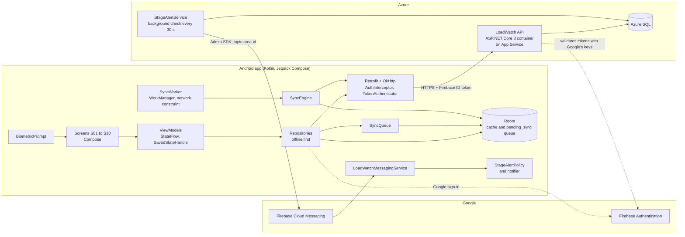

The app has three layers, and each package only talks to the layer below it:

| Package | Responsibility |
|---|---|
| `feature/*` | One package per screen: a Compose screen and its ViewModel. Features never import each other, and never reach Room or Retrofit directly. A unit test enforces this. |
| `navigation` | The only place that knows every feature. It holds the routes, the navigation graph, the app shell with the bottom bar, the lock screen and the pending-sync banner. |
| `data` | Repositories, remote and local data sources, mappers, sync, alert policy and the calendar logic |
| `core` | Room database, Retrofit client, authentication, biometrics, notifications, locale and the design system |

The API follows the same split:

| Folder | Holds |
|---|---|
| `Controllers` | One per resource |
| `Services` | Report rules, settings rules, history, accuracy and stage alerts |
| `Data` | EF Core context, migrations, seeding and startup retries |
| `Auth` | Firebase JWT validation and user filters |
| `Health` | The root and health endpoints |

## 5. Design decisions

- **Offline first, with Room as the source of truth.** Screens observe Room and never wait on the network.
  Refreshes write into Room, and the screen updates from there. During load-shedding the network is
  unreliable, so the cached schedule, history and favourites must always open.
- **Every write is safe to send twice.** Each report carries a `clientReportId` made on the phone, unique
  per user. A retry after a lost answer returns the original report instead of counting twice. A second
  report of the same event within a ten-minute window comes back as a duplicate.
- **One sync request, decided per item.** `POST /api/sync` takes the whole offline queue and answers for
  each item, so one bad item never blocks the rest.
- **Last write wins for settings, decided by time.** Settings are a single record. The phone sends the time
  each change was saved, and the API keeps the newer copy and returns it. A phone whose clock runs ahead is
  capped at the server's time.
- **Background sync through WorkManager.** One job with a network constraint, so it waits while offline and
  runs when connectivity returns, with exponential backoff from 30 seconds. A newer request replaces the
  waiting one, which is safe because every item can be sent twice.
- **Stage changes are detected on the server.** The API compares each area's stage with the last one it
  announced, and sends one data-only message to that area's topic. The phone then decides whether to show it:
  is it the user's area, are alerts on, is this alert type ticked, and what language should it be in. No user
  data is needed to send an alert.
- **South African dates everywhere.** History days and the calendar use Africa/Johannesburg dates whatever
  the phone's time zone is, so the app and the API always agree on which day an outage belongs to.
- **The API tolerates a paused database.** Migrations and seeding run in the background with retries for up
  to three minutes, `/` answers at once, and `/api` routes answer 503 with `Retry-After` until the database
  is ready. This suits the serverless Azure SQL tier, which pauses when idle.
- **Pinned library versions.** The Android build is pinned to AGP 9.0.1 and compileSdk 36.1, and libraries
  are held at the newest versions that build with them. See [Pinned versions](#pinned-versions).
- **No secret is committed.** The connection string, the Firebase service account and the release keystore
  all come from the environment.

## 6. API endpoints

Base URL: the Azure web app, for example `https://<your-app>.azurewebsites.net`. Bearer routes need a Firebase
ID token in `Authorization: Bearer <token>`. Every error is returned as ProblemDetails JSON.

| Method | Route | Auth | Purpose |
|---|---|---|---|
| GET | `/` | none | Answers at once that the API is running, without touching the database |
| GET | `/health` | none | 200 when the database is reachable, otherwise 503 with the reason |
| GET | `/api/areas?q={text}&page={n}` | none | Search the area catalogue |
| GET | `/api/areas/{areaId}` | none | One area with its municipality and supplier |
| GET | `/api/schedules?areaId=&from=&to=` | none | Scheduled windows for an area |
| GET | `/api/schedules/next?areaId=` | none | The current or next window |
| GET | `/api/stages/current` | none | The national stage |
| GET | `/api/areas/{areaId}/outage-reports?since=` | none | Recent community reports, without reporter ids |
| GET | `/api/areas/{areaId}/accuracy` | none | The area's accuracy score over 72 hours |
| GET | `/api/areas/{areaId}/history?month=yyyy-MM` | none | Past outages and reports for one month, by South African day |
| POST | `/api/outage-reports` | bearer | Submit a report. 201 new, 200 same `clientReportId` again, 409 duplicate inside the window. |
| POST | `/api/sync` | bearer | Send the offline queue: reports, favourite changes and settings. Answers with accepted, duplicates, superseded and rejected items. |
| GET | `/api/users/{userId}/settings` | bearer, own id | Read settings, created with defaults the first time |
| PUT | `/api/users/{userId}/settings` | bearer, own id | Save settings |
| GET | `/api/users/{userId}/favourites` | bearer, own id | List favourites |
| POST | `/api/users/{userId}/favourites` | bearer, own id | Add a favourite. 409 if already saved. |
| DELETE | `/api/users/{userId}/favourites/{areaId}` | bearer, own id | Remove a favourite; the area itself is kept |
| POST | `/api/notifications/registrations` | bearer | Register this phone's FCM token |
| POST | `/api/stages/areas/{areaId}/test-change` | `X-Stage-Test-Key` header | Demo only: change an area's stage and send the alert at once. Off unless a key is configured. |

Sample requests for every route are in `api/LoadWatch.Api/LoadWatch.Api.http`.

## 7. Database schema

### Azure SQL (EF Core, code-first migrations)

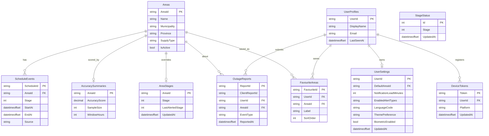

Key constraints:

- `OutageReports` is unique on `(UserId, ClientReportId)`, which makes report retries safe.
- `FavouriteAreas` is unique on `(UserId, AreaId)`.
- `ScheduleEvents` requires `EndAt > StartAt`.
- `StageStatus` is a single row holding the national stage. An area's stage is its `AreaStages.Stage` if set,
  otherwise the national stage.

### On the phone (Room, version 4)

| Table | Holds |
|---|---|
| `areas` | Cached area catalogue |
| `schedule_events` | Cached windows per area |
| `area_refresh` | When each area was last refreshed, and how far its cache reaches |
| `current_stage` | The national stage |
| `accuracy_summaries` | Cached accuracy scores |
| `user_settings` | The signed-in user's settings |
| `favourite_areas` | Favourites, including ones saved offline |
| `outage_reports` | The user's own reports with their sync status |
| `recent_areas` | Recently chosen areas for the selector |
| `pending_sync` | The offline queue: type, id, JSON payload, retry count, status and last error |
| `history_outages`, `history_reports`, `history_months` | The cached outage history, one month at a time |

Schemas are exported to `app/schemas`. Version upgrades use Room auto-migrations.

## 8. Security

**Firebase JWT validation (API).** Every bearer route validates the Firebase ID token with ASP.NET Core
JWT bearer authentication:

- **Issuer:** must be `https://securetoken.google.com/<project-id>`.
- **Audience:** must be the Firebase project id.
- **Lifetime:** the token must not have expired.
- **Signature:** checked against Google's public keys, which the API discovers from the issuer's OpenID
  metadata, so the API holds no Firebase secret for sign-in.

A missing, invalid or expired token gets a 401 ProblemDetails that says which. A global filter returns 403 if
the `{userId}` in a path is not the signed-in user. Reports never take a user id from the body; the reporter
is always the token's `sub`.

**Token handling (app).**

- `AuthInterceptor` adds the current ID token to bearer routes.
- On a 401, `TokenAuthenticator` refreshes the token once.
- If the refresh fails, the app signs out and returns to S02 with an explanation.
- Signing out clears all user data from Room and leaves the public area catalogue and schedules.

**Biometric unlock (app).**

- **Turning it on:** the user does this in Settings. It is only stored after a successful `BiometricPrompt`,
  so the phone has shown it can unlock.
- **On every launch:** the screens are not composed until the user unlocks, so nothing behind the lock is
  visible or reachable with a screen reader.
- **Methods accepted:** strong or weak biometrics, with the PIN, pattern or password as the fallback.
- **Edge cases:** cancelling leaves the lock screen up with Unlock and Sign out. A phone with no enrolled
  biometric or screen lock is told why.

**Secrets and the release build.**

- **Connection string:** `ConnectionStrings__LoadWatchDb`, set in the Azure web app.
- **Firebase service account:** `FIREBASE_SERVICE_ACCOUNT_JSON`, set in the Azure web app.
- **Demo key:** `StageAlerts__TestKey`, set in the Azure web app.
- **Release keystore and passwords:** come from Gradle properties or environment variables. Keystore files
  and signing property files are git-ignored.
- **Release APK:** shrunk and obfuscated with R8.

## 9. DevOps

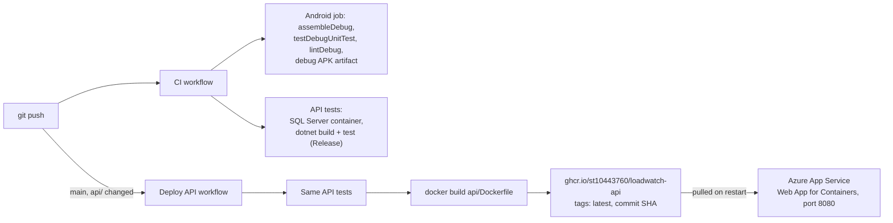

### CI (`.github/workflows/ci.yml`)

Runs on every push to any branch and on every pull request. The badge at the top shows its latest result.

- **Android job.** JDK 21 and SDK platform 36.1, with Gradle cached between runs. It runs
  `./gradlew assembleDebug`, `testDebugUnitTest` and `lintDebug`, so any lint error fails the run. It uploads
  the debug APK as `loadwatch-debug-apk`, and on failure it also uploads the test and lint reports. With no
  `local.properties` on the runner, the build uses the placeholder API URL.
- **API job.** Calls the reusable `api-tests.yml`. That starts SQL Server 2022 in Docker with a password made
  for the run and hidden in the logs, then builds and tests the API in Release. LocalDB is Windows only, so
  the tests use the container through `LOADWATCH_TEST_SQL`.

### Deploy API (`.github/workflows/deploy-api.yml`)

Runs on a push to `main` that changes `api/`, or by hand from the Actions tab.

1. It runs the same API tests.
2. If they pass, it builds `api/Dockerfile` and pushes the image to GitHub Container Registry as
   `ghcr.io/st10443760/loadwatch-api`, tagged `latest` and with the commit SHA. It signs in with the built-in
   `GITHUB_TOKEN`, so no Azure secret is involved.

The Azure web app runs `ghcr.io/st10443760/loadwatch-api:latest` and pulls the newest image when restarted.
The container listens on port 8080, so set `WEBSITES_PORT=8080` (on the sidecar setup, set the port on the
main container in Deployment Center).

The web app's settings:

| Setting | Value |
|---|---|
| Connection string `LoadWatchDb` | The Azure SQL connection string |
| `Firebase__ProjectId` | The Firebase project id |
| `FIREBASE_SERVICE_ACCOUNT_JSON` | The service account key JSON, needed for stage-change alerts |
| `StageAlerts__TestKey` | Optional; turns on the demo endpoint |

## 10. Languages supported

| Language | Resources | Notes |
|---|---|---|
| English | `values` | Default |
| isiZulu | `values-zu` | Full translation |
| Afrikaans | `values-af` | Full translation |

- **Switching:** the language picker in Settings switches language at once through AppCompat's per-app
  locales and saves the choice with the account.
- **Android 13 and later:** the language also appears in the system's per-app language settings.
- **Alerts:** stage-change notifications use the chosen language.
- **Coverage:** a unit test fails the build if any string is missing from isiZulu or Afrikaans, or if a
  translation changes a placeholder.

## 11. Screenshots

These screenshots were taken on a Samsung phone. The files are in `docs/screenshots/`.

| Screen | Image |
|---|---|
| S02 Sign in | 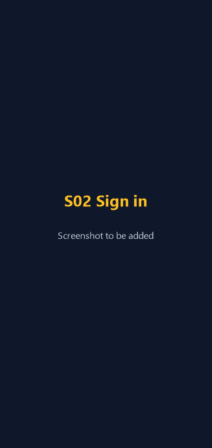 |
| S04 Home with countdown | 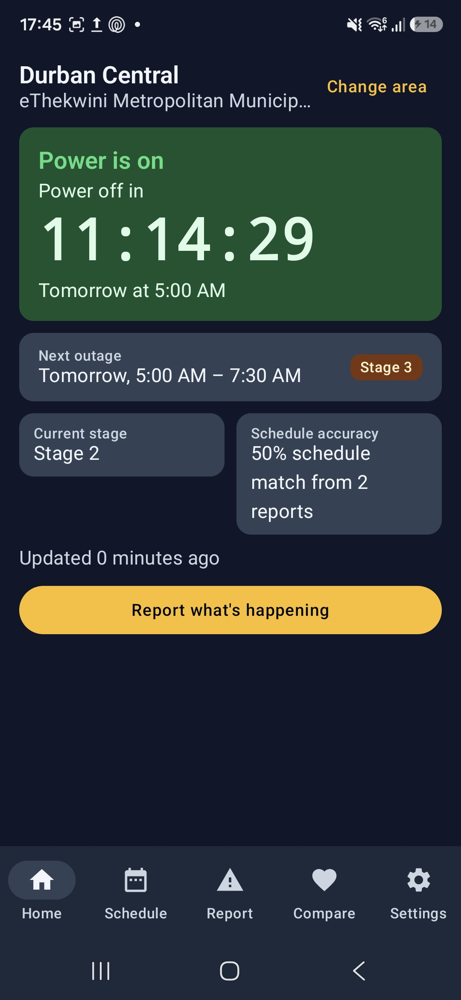 |
| S06 Schedule | 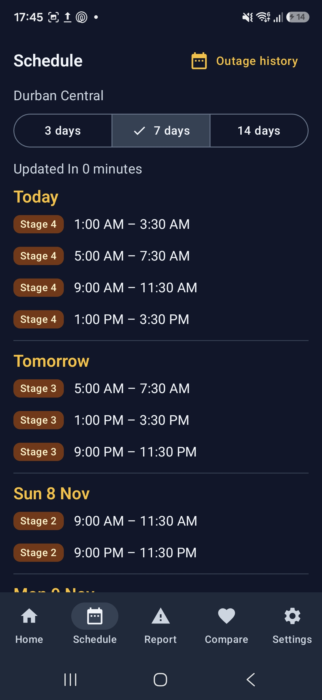 |
| S07 Report and accuracy | 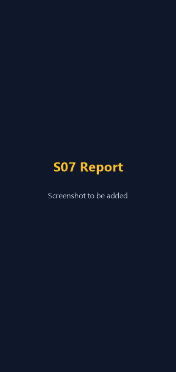 |
| S08 Compare favourites | 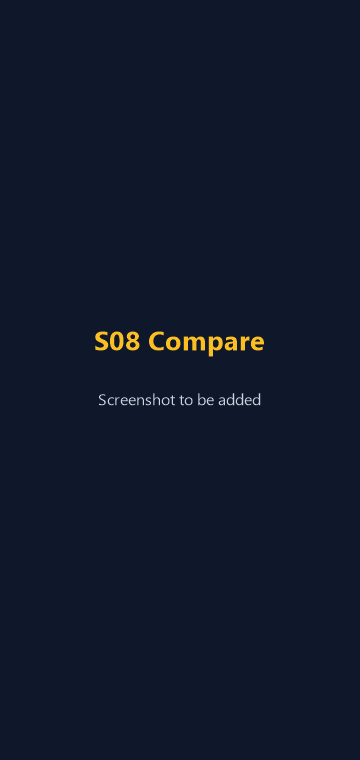 |
| S09 Settings | 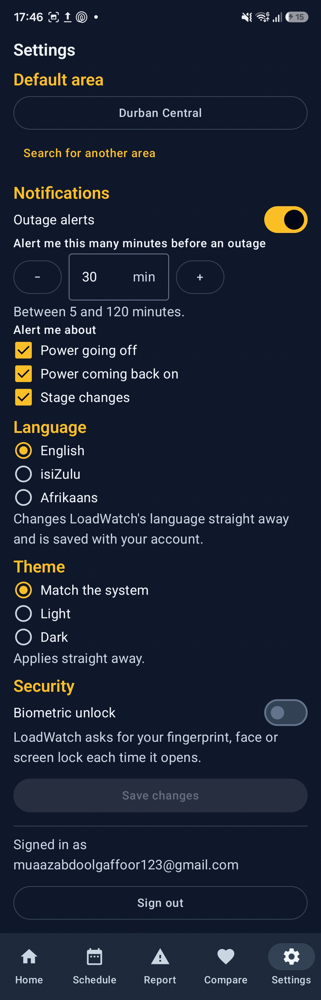 |
| S10 Outage history calendar | 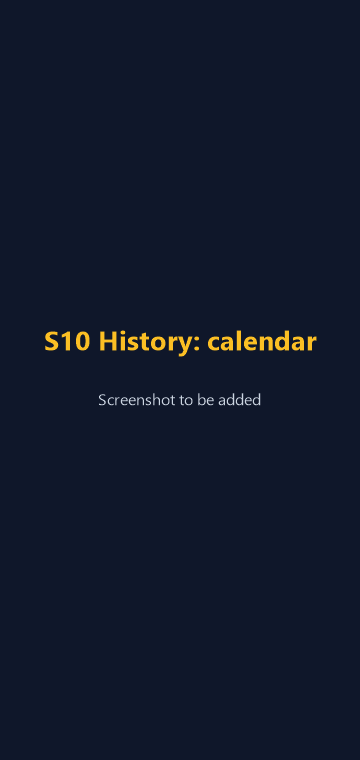 |
| S10 Outage history list |  |
| Biometric lock | 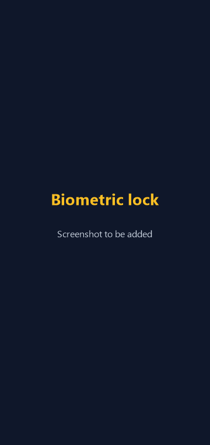 |
| Stage-change notification on the home screen | 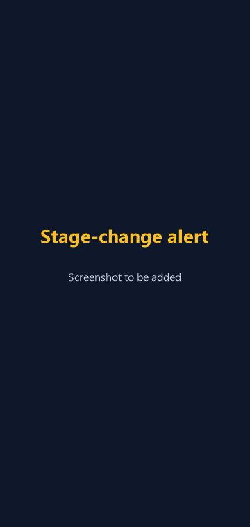 |
| Offline banner and pending report | 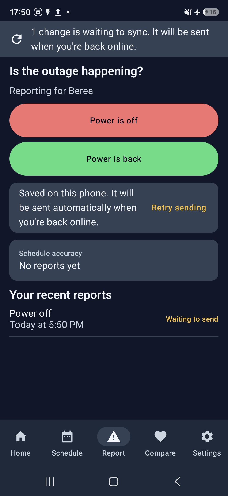 |
| Home in isiZulu, with the offline banner | 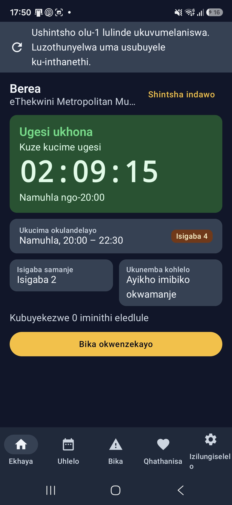 |

## 12. How to build and run

### Requirements

- Android Studio with its bundled JDK (JDK 21)
- Android SDK platform 36.1 (API 36, minor level 1), installed through the SDK Manager
- .NET 8 SDK or newer, plus SQL Server LocalDB, to run the API locally

### Pinned versions

The Android project is pinned to these versions on purpose. Newer releases of several libraries need
Android Gradle plugin 9.1 and compileSdk 37, and fail the build's AAR metadata check. Do not bump anything
here without upgrading AGP and compileSdk together. The reasons are also recorded at the top of
`gradle/libs.versions.toml`.

| Component | Version | Why it is pinned |
|---|---|---|
| Android Gradle plugin | 9.0.1 | The version this Android Studio install syncs with |
| compileSdk / targetSdk | 36.1 / 36 | Newest platform installed |
| Kotlin | 2.2.10 | Must match the Kotlin built into AGP 9.0.1 |
| KSP | 2.3.12 | |
| Compose BOM | 2025.09.01 | Keeps every Compose library on Compose UI 1.9.2 |
| core-ktx | 1.18.0 | 1.19.x needs AGP 9.1 and compileSdk 37 |
| Lifecycle | 2.10.0 | 2.11.x needs AGP 9.1 and compileSdk 37 |
| Navigation Compose | 2.9.8 | 2.10.x pulls in Lifecycle 2.11 |
| Hilt | 2.60.1 | |
| Hilt Lifecycle ViewModel Compose | 1.3.0 | 1.4.0 needs AGP 9.1 |
| Room | 2.8.5 | |
| Retrofit | 3.0.0 | |
| OkHttp | 5.4.0 | 5.5.x needs compileSdk 37 |
| kotlinx serialization | 1.9.0 | |
| Coroutines | 1.10.2 | |
| Firebase BoM | 34.19.0 | 35.x is compiled with Kotlin 2.4 |
| Biometric | 1.1.0 | Newest stable release |
| AppCompat | 1.7.1 | Hosts the biometric prompt and the per-app language before Android 13 |
| WorkManager | 2.10.5 | Newest 2.10 release; runs the offline sync |

### API base URL

The app reads the API address from `local.properties` in the project root, under `api.base.url`. That file
is not committed, so each machine sets its own:

```properties
api.base.url=https://your-loadwatch-api.azurewebsites.net/
```

Put the key on its own line. A trailing slash is added if missing. Without the key, the app builds with the
placeholder `https://loadwatch-api.invalid/`, which never resolves. A physical phone cannot reach `localhost`
on your computer, so use the hosted API or your computer's LAN address. Re-sync Gradle after changing it.

### Build and test the app

```bash
./gradlew assembleDebug
./gradlew testDebugUnitTest
./gradlew lintDebug
```

The debug APK is written to `app/build/outputs/apk/debug/app-debug.apk`. The unit tests include two checks:

- No feature package imports another feature package or reaches Room or the API directly.
- Every string is translated into isiZulu and Afrikaans with the same placeholders.

### Build the signed release APK

The release build is shrunk and obfuscated with R8 (`isMinifyEnabled` and `isShrinkResources`). It is
signed with a keystore that never enters the repo. The build reads four values, from Gradle properties or
from environment variables of the same name:

| Name | Value |
|---|---|
| `LOADWATCH_KEYSTORE_PATH` | Full path to the `.jks` file |
| `LOADWATCH_KEYSTORE_PASSWORD` | The keystore password |
| `LOADWATCH_KEY_ALIAS` | The key alias, for example `loadwatch` |
| `LOADWATCH_KEY_PASSWORD` | The key password |

Put them in your user-level `%USERPROFILE%\.gradle\gradle.properties`, never in the project's
`gradle.properties`. Then run:

```bash
./gradlew assembleRelease
```

The signed APK is written to `app/build/outputs/apk/release/app-release.apk`. If any of the four values is
missing, the build still succeeds but writes `app-release-unsigned.apk` and logs a warning.

### Run the API locally

```bash
cd api/LoadWatch.Api
dotnet run
```

The development connection string in `appsettings.Development.json` points at a LocalDB database named
`LoadWatchDb`.

- **On start:** the API applies any pending EF Core migrations. It then seeds the Durban areas, the current
  stage, a 14-day schedule and, once, the previous 60 days for the outage history.
- **In the background:** this runs after the API starts listening. Errors from a paused Azure SQL database
  are retried for up to three minutes.
- **On a permanent error:** for example a wrong password, the API logs it and exits with code 1.

### Run the API in a container

```bash
docker build -t loadwatch-api api
docker run -p 8080:8080 -e "ConnectionStrings__LoadWatchDb=<your connection string>" loadwatch-api
```

This is the image the deploy workflow publishes. It listens on port 8080 as a non-root user. The container
cannot reach LocalDB, so give it a SQL Server it can reach.

### Test the API

```bash
dotnet test api/LoadWatch.Api.Tests
```

Each test class creates its own throwaway database and deletes it afterwards. Locally the tests use LocalDB.
To use another SQL Server, set `LOADWATCH_TEST_SQL` to a connection string without a database name, as CI
does.

### Logcat

Every log line uses a tag from `LogTags` starting with `LW.`, so filtering Logcat on `LW.` shows only
LoadWatch:

| Tag | What it shows |
|---|---|
| `LW.Lifecycle` | Activity and screen lifecycle, ViewModels created and cleared, language and theme changes |
| `LW.Navigation` | Every navigation transition and where Back leads |
| `LW.State` | Screen states changing kind, for example Loading to Ready |
| `LW.Auth` | Sign-in, sign-out and session expiry |
| `LW.Biometric` | Availability checks, the launch lock and every prompt outcome |
| `LW.Api` | HTTP traffic and API results, with server errors logged as errors |
| `LW.Room` | The database opening and data being cached |
| `LW.Sync` | Changes queued offline, the sync worker starting and finishing, each batch outcome, retries and rejections |
| `LW.Countdown` | The home countdown rolling over to the next window |
| `LW.Push` | FCM token registration, area topic changes and incoming stage alerts |

### Demo: stage-change alert

With `StageAlerts__TestKey` set on the API, this sets Berea to stage 6 and sends the alert at once:

```bash
curl -X POST https://your-loadwatch-api.azurewebsites.net/api/stages/areas/eth-berea/test-change \
  -H "Content-Type: application/json" -H "X-Stage-Test-Key: <your key>" -d '{"stage": 6}'
```

The response says whether the alert was `Sent`, `Skipped` (Firebase not configured), `Failed` or `NoChange`.
A `null` stage puts the area back on the national stage.

### Demo: offline sync

1. Open **Report** and turn on Aeroplane mode.
2. Tap **Power is off**. The report shows as *Waiting to send*, and a banner says one change is waiting to
   sync.
3. Optionally, still offline, add a favourite or change a setting. Each is saved on the phone and the banner
   count goes up.
4. Turn Aeroplane mode off. Within moments the banner disappears and the report shows as *Accepted*. Logcat
   on `LW.Sync` shows the worker starting, the batch sent and the outcome.

## 13. AI usage

How AI tools were used in this project, what I did myself and how the output was checked is declared in
[docs/ai-usage.md](docs/ai-usage.md).

## 14. Release notes and Play Store readiness

- [RELEASE_NOTES.md](RELEASE_NOTES.md) lists every change since the Part 2 prototype and marks the features
  that are new in the final version.
- [docs/play-store-listing.md](docs/play-store-listing.md) holds the store listing, the data safety summary,
  the signing and versioning details, and the promotional screenshots.
